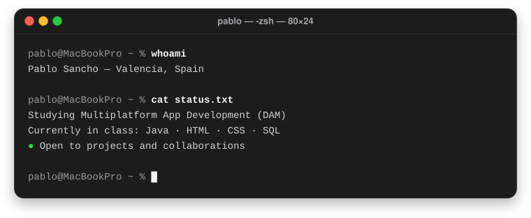
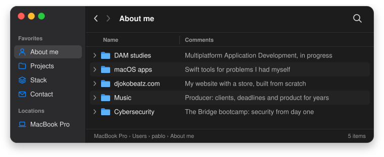
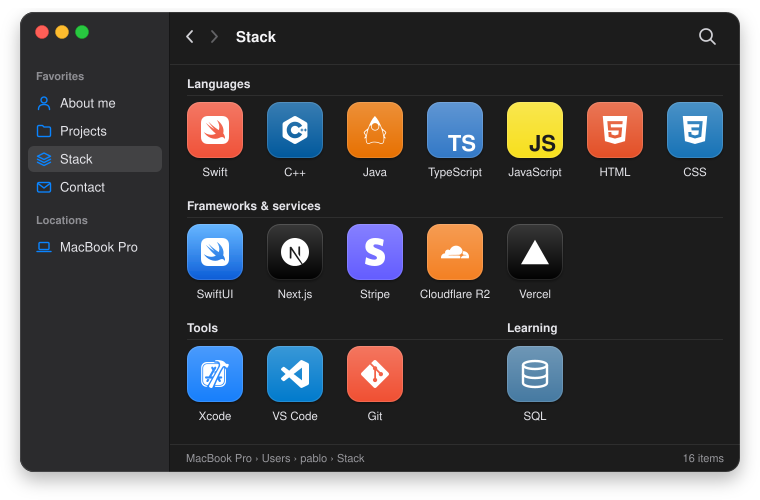

# Pablo Sancho

App developer &nbsp;·&nbsp; macOS &nbsp;·&nbsp; Web &nbsp;·&nbsp; Multiplatform App Development student

[🇪🇸 Versión en español](./README.md)

 

&nbsp;

  

## About me

  

## Projects

  

&nbsp;

&nbsp;

&nbsp;

## Stack

  

## Contact

  

