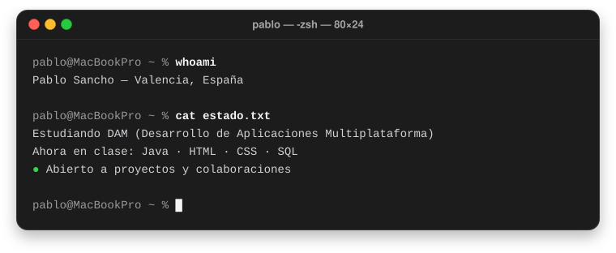
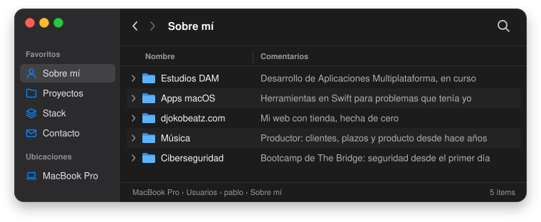
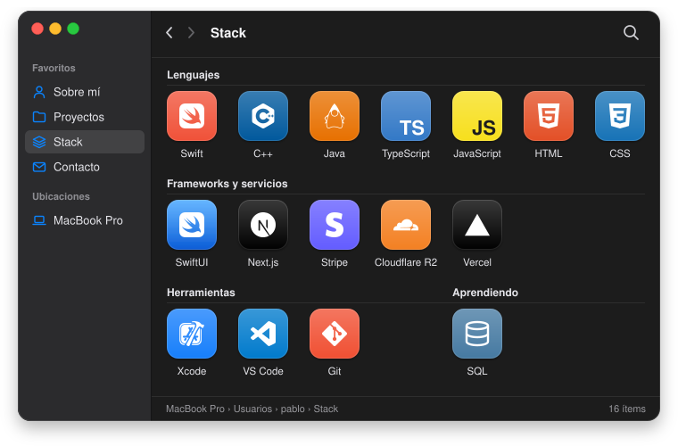
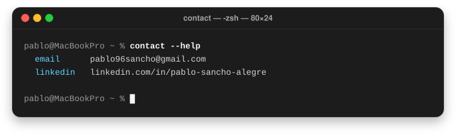

# Pablo Sancho

Desarrollador de aplicaciones &nbsp;·&nbsp; macOS &nbsp;·&nbsp; Web &nbsp;·&nbsp; Estudiante de DAM

[🇬🇧 English version](./README.en.md)

 

&nbsp;

  

## Sobre mí

  

## Proyectos

  

&nbsp;

&nbsp;

&nbsp;

## Stack

  

## Contacto

  

